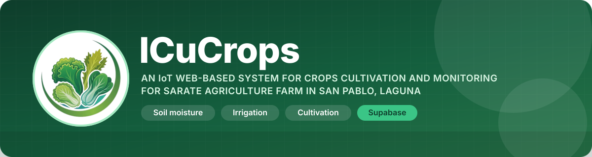
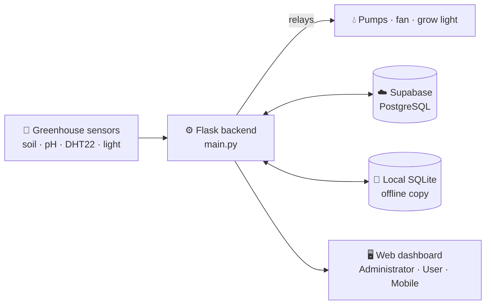
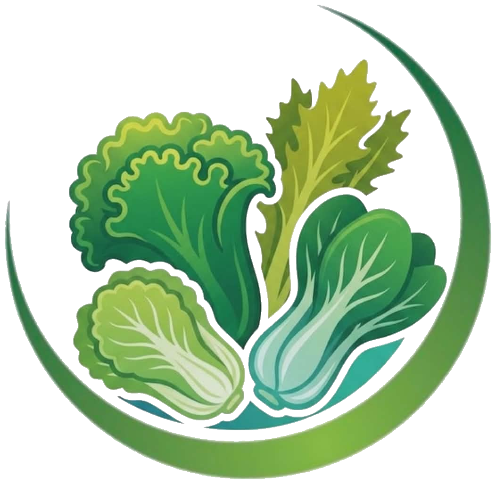

<p align="center">
  
</p>

<p align="center">
  
  
  
  
  
  
  
  
  
</p>

<p align="center">
  <b>ICuCrops</b> watches every planted row in the greenhouse — soil moisture, soil pH,
  temperature, humidity and light — and waters, ventilates and lights the crops on its own.
  <br>
  Growers and administrators follow the farm live from a web dashboard backed by
  <b>Supabase</b>.
</p>

---

## 🌱 About

ICuCrops is an IoT web-based system for crops cultivation and monitoring, built for
Sarate Agriculture Farm in San Pablo, Laguna. Sensors in the soil and in
the air report their readings to a Flask backend, which stores them, decides when to
irrigate, run the fan or switch on the grow light, and serves a web dashboard where
people see every row at a glance and control the equipment by hand when they need to.

**Supabase (PostgreSQL)** is the cloud database. It holds the accounts, sensor
readings, cultivations, irrigation controls, notifications and history, so the dashboard
works from anywhere, and a local SQLite copy keeps the greenhouse running when the
internet drops.

> This repository contains the basic **frontend** and **backend** source code only.
> The sensor firmware and hardware-communication code are not included.

> [!IMPORTANT]
> 🔒 **No sensitive information is included in this repository.**
> There are **no API keys**, no `.env` files, no passwords, no Supabase connection
> strings, no tokens and no database files here. Every secret is read from the
> environment of the machine that runs ICuCrops and is never written into the code.

---

## 🗄️ Database

<table>
  <tr>
    <td width="50%" align="center" valign="top">
      
      <h3>Supabase</h3>
      <p><b>Cloud database (PostgreSQL)</b></p>
      <p>The main online store for accounts, sensor readings, cultivations, irrigation
      controls, notifications and history. The website reads and writes here, so the
      farm can be followed from anywhere.</p>
    </td>
    <td width="50%" align="center" valign="top">
      
      <h3>SQLite</h3>
      <p><b>Local database (offline copy)</b></p>
      <p>Runs beside the greenhouse so sensors, automation and the kiosk keep working
      when the internet is down. It syncs with Supabase once the connection is back.</p>
    </td>
  </tr>
</table>

---

## 💻 Languages used

<p align="center">
  
</p>

| Language | Where it is used |
| --- | --- |
|  **Python** | Backend — Flask server, automation rules, database layer, reports |
|  **JavaScript** | Frontend logic — dashboard, live graphs, controls, real-time sync |
|  **HTML5** | Every page of the Administrator, User, sign-in and mobile portals |
|  **CSS3** | Styling, emerald theme, dark mode, mobile and kiosk layouts |
|  **SQL** | Supabase (PostgreSQL) schema migrations and SQLite queries |

---

## ✨ Features

<table>
  <tr>
    <td width="50%" valign="top">

### 💧 Smart irrigation
- Live soil-moisture reading for every row
- **Automatic**, **Manual** and **Scheduled** watering modes
- Safety bands that stop watering at the right moisture level
- Misting that follows the irrigation

    </td>
    <td width="50%" valign="top">

### 🌡️ Greenhouse climate
- Temperature and humidity (DHT22) and light sensing
- Fan runs on high humidity
- Grow light runs in the dark, with a daily limit
- Lime tank control for soil pH

    </td>
  </tr>
  <tr>
    <td width="50%" valign="top">

### 📊 Monitoring & reports
- Real-time dashboard and live graphs
- Per-sensor detail pages and history log
- Downloadable reports as **Excel (.xlsx)** and **PDF**
- Alerts and notifications

    </td>
    <td width="50%" valign="top">

### 🌾 Cultivation tracking
- Plant and track crops per row
- Growth parameters and harvest records
- Cultivation requests from growers, approved by admins
- Harvest outcome tracking

    </td>
  </tr>
  <tr>
    <td width="50%" valign="top">

### 🔐 Accounts & security
- Separate **Administrator** and **User** portals
- Email OTP password reset
- Single-session sign-in per account
- Profile management with photos

    </td>
    <td width="50%" valign="top">

### 📱 Works everywhere
- Desktop web dashboard
- Mobile-friendly pages
- Touch kiosk mode for the greenhouse panel
- Light and dark appearance

    </td>
  </tr>
</table>

---

## 🧭 How it works



---

## 🛠️ Tech stack

| Layer | Technology |
| --- | --- |
| **Database** | **Supabase** (PostgreSQL) in the cloud + **SQLite** locally for offline use |
| **Backend** | Python 3.11+, Flask, psycopg, Pillow |
| **Languages** | Python, JavaScript, HTML5, CSS3, SQL |
| **Frontend** | HTML5, CSS3, vanilla JavaScript — no framework |
| **Reports** | Built-in Excel (.xlsx) and PDF writers |

---

## 📁 Project structure

```text
icucrops-source-code/
├── administrator/        # Administrator portal: dashboard, irrigation, cultivation,
│                         # sensors, history, user management, settings
├── user/                 # Grower portal: the same pages without admin tools
├── auth/                 # Sign-in and password-reset pages
├── mobile_web/           # Mobile layouts for both portals
├── assets/               # Shared styles, scripts, icons, logos and images
├── supabase/
│   └── migrations/       # Supabase PostgreSQL schema
├── main.py               # Flask backend: pages, REST endpoints, automation rules
├── icucrops_pg.py        # Supabase / PostgreSQL data layer
├── icucrops_reports.py   # Excel and PDF report builder
└── requirements.txt      # Python dependencies
```

---

## 🚀 Getting started

**1. Clone and install**

```bash
git clone https://github.com/Levi-crown/icucrops-source-code.git
cd icucrops-source-code
python -m venv .venv
# Windows: .venv\Scripts\activate   ·   macOS/Linux: source .venv/bin/activate
pip install -r requirements.txt
```

**2. Set up Supabase**

1. Create a project on [Supabase](https://supabase.com).
2. Run the SQL files in [`supabase/migrations/`](supabase/migrations) in order
   (`0001` → `0007`) from the Supabase SQL editor.
3. Give the backend your own Supabase connection string and secrets through
   environment variables on your machine. They are not part of this repository —
   never commit them.

**3. Run**

```bash
python main.py
```

---

## 👥 Team

<p align="center">
  
  
  
  
</p>

<p align="center">
  
  <br>
  <sub>🌿 ICuCrops · An IoT Web-Based System for Crops Cultivation and Monitoring for Sarate Agriculture Farm in San Pablo, Laguna</sub>
</p>
